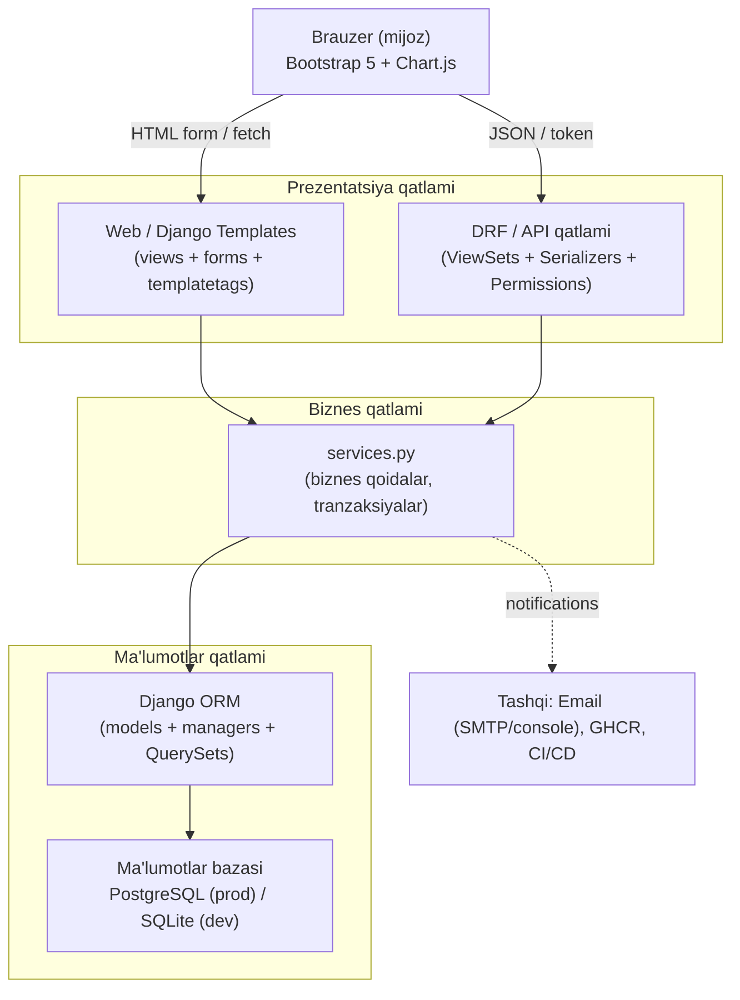
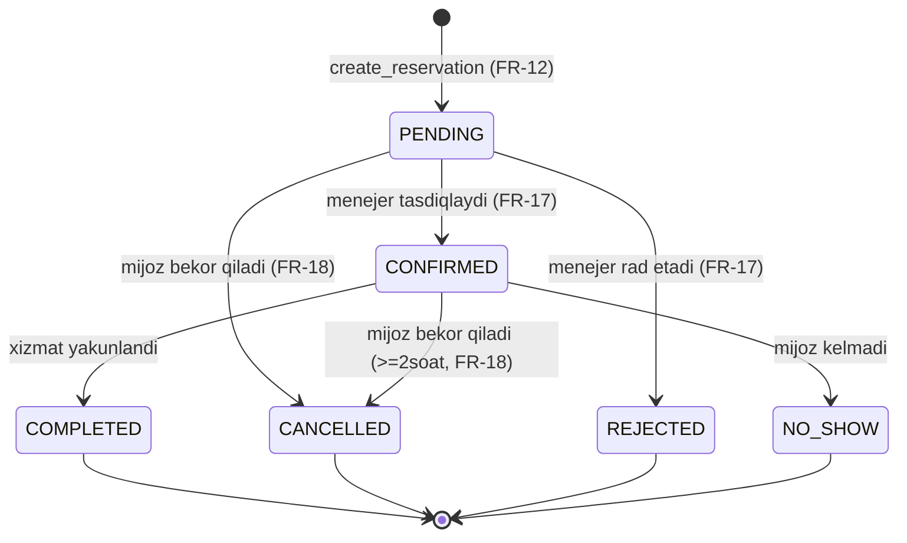

# TableReserve: Dizayn hujjati (Design)

> Kafe stol rezervatsiyasi platformasi
> Fan: DevOps va CI/CD texnologiyalari (Amaliy mashg'ulot)
> Muallif: Sadullayev Jaxongir
> Spec-driven jarayonning 2-bosqichi (`requirements.md` → **`design.md`** → `tasks.md`)
> Til: interfeys va hujjatlar o'zbek (lotin); kod identifikatorlari va commit xabarlari ingliz tilida.

---

## 1. Kirish va maqsad

Ushbu hujjat **TableReserve** platformasining texnik dizaynini belgilaydi. U
tasdiqlangan [`requirements.md`](./requirements.md) hujjatidagi funksional (`FR-01…FR-30`)
va nofunksional (`NFR-01…NFR-12`) talablarni amaliy arxitektura, ma'lumotlar modeli,
servis qatlami, API va infratuzilma qarorlariga aylantiradi.

### 1.1. Hujjatning qamrovi

- Ko'p qatlamli arxitektura va uning asoslanishi (`NFR-03`, `NFR-09`, `NFR-11`).
- Barcha Django ilovalaridagi ma'lumotlar modeli: maydonlar, bog'lanishlar,
  multiplicity, indekslar (`NFR-03`) va cheklovlar.
- Biznes-logikani `services.py` qatlamiga ajratish (`key_patterns`).
- Bron to'qnashuvining oldini olish strategiyasi (`FR-13`, `NFR-11`).
- Bron holatlari mashinasi (`FR-16`, `FR-17`, `FR-18`).
- Modullar jadvali, API dizayni (`FR-24`), xatoliklar, logging, health-check
  (`FR-25`, `FR-29`, `NFR-08`).
- Loyiha katalog tuzilmasi va keyingi bosqichda yaratiladigan UML diagrammalar
  to'plami (`NFR-12`).

### 1.2. Talablarni dizaynga bog'lash (traceability)

| Talab guruhi | Dizayn bo'limi |
|--------------|----------------|
| `FR-01…FR-07` (auth, RBAC) | §2, §3 (`accounts`), §4 (`accounts.services`), §8 (permissions) |
| `FR-08…FR-10` (CRUD) | §3 (`cafes`, `tables`), §4 (servislar), §7 (modullar) |
| `FR-11…FR-15` (qidiruv/bron) | §4 (`reservations.services`), §5 (to'qnashuv) |
| `FR-16…FR-21` (holatlar, sharh) | §6 (holat mashinasi), §3 (`reviews`) |
| `FR-22…FR-24` (dashboard, API) | §2, §8 (API dizayni) |
| `FR-25…FR-30` (health, audit, xato, mavzu) | §3 (`core.AuditLog`), §10 (xato/log/health) |
| `NFR-01…NFR-12` | §2, §3 (indeks/cheklov), §9 (tuzilma), §10, §11 |

---

## 2. Ko'p qatlamli arxitektura

### 2.1. Umumiy ko'rinish

Platforma **toza qatlamlar ajratilishi** (separation of concerns) tamoyili asosida
quriladi. So'rov quyi qatlamga faqat bevosita quyidagi qatlam orqali tushadi; har
qatlamning mas'uliyati aniq chegaralangan. Bu `NFR-09` (code quality, DRY) va
`NFR-03` (performance) talablarini qondiradi, hamda testlashni osonlashtiradi
(`NFR-05`).



### 2.2. Qatlamlarning mas'uliyati

| Qatlam | Mas'uliyat | Asosiy komponentlar | Talablar |
|--------|------------|---------------------|----------|
| **Web / Templates** | HTML sahifalar, formalar, server-side render, CSRF, auto-escaping, mavzu toggle | `views.py` (CBV/FBV), `forms.py`, `templates/`, `static/`, `templatetags/` | `FR-01…FR-05`, `FR-19`, `FR-20`, `FR-22`, `FR-29`, `FR-30`, `NFR-01`, `NFR-04` |
| **DRF / API** | REST endpointlar, serializatsiya, token/session auth, rol permissionlari, OpenAPI | `api/` (routerlar), har app ichida `serializers.py`, `api_views.py`, `permissions.py` | `FR-24`, `FR-06`, `FR-07` |
| **Services (biznes)** | Barcha biznes qoidalar: qidiruv, bron yaratish, to'qnashuv tekshiruvi, holat o'tishlari, bildirishnoma, audit, statistika | har app ichida `services.py` | `FR-11…FR-18`, `FR-21`, `FR-22`, `FR-26`, `FR-27` |
| **ORM (ma'lumotlar)** | Model ta'riflari, managerlar, QuerySetlar, migratsiyalar, cheklovlar, indekslar | har app ichida `models.py`, `managers.py`, `migrations/` | `NFR-03`, `FR-13`, `NFR-11` |
| **DB** | Doimiy saqlash; `ExclusionConstraint` (PostgreSQL), SQLite fallback | PostgreSQL 16 / SQLite 3 | `NFR-11`, `FR-13` |

### 2.3. Asoslash (rationale)

- **Nega `services.py`?** Views va serializerlar faqat so'rov/javob bilan ishlaydi;
  murakkab qoidalar (bron to'qnashuvi, holat o'tishi, statistika) servislarda
  markazlashadi. Shu tufayli bir xil logika ham Template view, ham DRF endpoint
  tomonidan qayta ishlatiladi (DRY, `NFR-09`) va unit-test oson bo'ladi (`NFR-05`).
- **Nega DB darajasidagi cheklov?** Ilova darajasidagi tekshiruv race-condition'ga
  zaif. PostgreSQL `ExclusionConstraint` ikki parallel bronning ikkalasini ham
  saqlashiga yo'l qo'ymaydi (`FR-13`), SQLite esa `clean()` + servis tekshiruvi
  bilan himoyalanadi (`NFR-11`).

---

## 3. Ma'lumotlar modeli

Ushbu bo'lim barcha Django ilovalaridagi modellarni tavsiflaydi. Barcha modellar
`created_at` / `updated_at` (audit uchun `auto_now_add` / `auto_now`) maydonlarini
beruvchi abstrakt `core.TimeStampedModel` dan meros oladi.

### 3.1. ER diagrammasi (Mermaid)

```mermaid
erDiagram
    USER ||--o{ CAFE : "manages (MANAGER)"
    USER ||--o{ RESERVATION : "books (CUSTOMER)"
    USER ||--o{ REVIEW : "writes"
    USER ||--o{ AUDITLOG : "acts"
    CAFE ||--o{ ZONE : "has"
    CAFE ||--o{ REVIEW : "receives"
    ZONE ||--o{ TABLE : "contains"
    TABLE ||--o{ RESERVATION : "reserved in"
    RESERVATION ||--o| REVIEW : "may have"

    USER {
        bigint id PK
        string email UK
        string username
        string role "ADMIN|MANAGER|CUSTOMER|WAITER"
        string first_name
        string last_name
        string phone
        bool is_active
        datetime date_joined
    }
    CAFE {
        bigint id PK
        bigint manager_id FK
        string name
        slug slug UK
        string address
        string phone
        text description
        time opening_time
        time closing_time
        image image
        bool is_active
    }
    ZONE {
        bigint id PK
        bigint cafe_id FK
        string name
        string zone_type "HALL|TERRACE|VIP"
    }
    TABLE {
        bigint id PK
        bigint zone_id FK
        string number
        int capacity
        string status "AVAILABLE|INACTIVE"
    }
    RESERVATION {
        bigint id PK
        bigint customer_id FK
        bigint table_id FK
        datetime start_time
        int duration_minutes
        int guests_count
        string status "PENDING|CONFIRMED|COMPLETED|CANCELLED|REJECTED|NO_SHOW"
        text note
        datetimerange time_range "generated"
    }
    REVIEW {
        bigint id PK
        bigint reservation_id FK_UK
        bigint cafe_id FK
        bigint author_id FK
        int rating "1..5"
        text comment
    }
    AUDITLOG {
        bigint id PK
        bigint actor_id FK
        string action "CREATE|UPDATE|DELETE"
        string object_type
        string object_id
        json changes
        datetime created_at
    }
```

### 3.2. `core.TimeStampedModel` (abstrakt)

| Maydon | Tur | Tavsif |
|--------|-----|--------|
| `created_at` | `DateTimeField(auto_now_add=True, db_index=True)` | Yaratilgan vaqt |
| `updated_at` | `DateTimeField(auto_now=True)` | Oxirgi o'zgarish |

`class Meta: abstract = True`. Barcha domen modellari bundan meros oladi (`NFR-03`
uchun `created_at` indeksli).

### 3.3. `accounts.User` (`FR-01…FR-07`, `FR-06`)

Maxsus foydalanuvchi modeli: `AbstractUser` + `role`. `AUTH_USER_MODEL = "accounts.User"`.

| Maydon | Tur | Cheklov / Izoh |
|--------|-----|----------------|
| `email` | `EmailField(unique=True)` | Login identifikatori; `USERNAME_FIELD = "email"` (`FR-01`) |
| `username` | `CharField` | `AbstractUser` dan; ko'rinish uchun |
| `role` | `CharField(max_length=16, choices=Role.choices, default=Role.CUSTOMER, db_index=True)` | RBAC (`FR-06`) |
| `phone` | `CharField(max_length=32, blank=True)` | Aloqa |
| `first_name`, `last_name`, `is_active`, `date_joined` | `AbstractUser` meros | Standart |

**`Role` (TextChoices):** `ADMIN="ADMIN"`, `MANAGER="MANAGER"`, `CUSTOMER="CUSTOMER"`, `WAITER="WAITER"`.

- **Manager:** `UserManager` (`email` asosida `create_user` / `create_superuser`).
- **Qulaylik xususiyatlari:** `is_admin`, `is_manager`, `is_customer`, `is_waiter`.
- **Indeks:** `role`.

### 3.4. `cafes.Cafe` (`FR-08`) va `cafes.Zone` (`FR-09`)

**`Cafe`**

| Maydon | Tur | Cheklov / Izoh |
|--------|-----|----------------|
| `manager` | `ForeignKey(User, on_delete=PROTECT, related_name="managed_cafes", limit_choices_to={"role": "MANAGER"})` | Kafe egasi/menejeri |
| `name` | `CharField(max_length=160)` | Kafe nomi |
| `slug` | `SlugField(unique=True)` | URL uchun |
| `address` | `CharField(max_length=255)` | Manzil |
| `phone` | `CharField(max_length=32)` | Telefon |
| `description` | `TextField(blank=True)` | Tavsif |
| `opening_time` | `TimeField()` | Ochilish (`FR-14`) |
| `closing_time` | `TimeField()` | Yopilish (`FR-14`) |
| `image` | `ImageField(upload_to="cafes/", blank=True)` | Rasm |
| `is_active` | `BooleanField(default=True, db_index=True)` | Faollik |

- **Bog'lanish:** `Cafe` *N → 1* `User` (manager). `Cafe` *1 → N* `Zone`, *1 → N* `Review`.
- **Indeks:** `slug` (unique), `is_active`, `(name,)`.
- **Hosila xususiyat:** `average_rating` (annotation yoki servis orqali, `FR-21`).

**`Zone`**

| Maydon | Tur | Cheklov / Izoh |
|--------|-----|----------------|
| `cafe` | `ForeignKey(Cafe, on_delete=CASCADE, related_name="zones")` | Tegishli kafe |
| `name` | `CharField(max_length=80)` | Zona nomi |
| `zone_type` | `CharField(max_length=12, choices=ZoneType.choices)` | `HALL`/`TERRACE`/`VIP` |

- **`ZoneType` (TextChoices):** `HALL`, `TERRACE`, `VIP`.
- **Bog'lanish:** `Zone` *N → 1* `Cafe`; *1 → N* `Table`.
- **Cheklov:** `UniqueConstraint(fields=["cafe", "name"], name="uniq_zone_name_per_cafe")`.

### 3.5. `tables.Table` (`FR-10`)

| Maydon | Tur | Cheklov / Izoh |
|--------|-----|----------------|
| `zone` | `ForeignKey(Zone, on_delete=CASCADE, related_name="tables")` | Tegishli zona |
| `number` | `CharField(max_length=16)` | Stol raqami/kodi |
| `capacity` | `PositiveSmallIntegerField()` | Sig'im (`CheckConstraint capacity >= 1`, `FR-10`) |
| `status` | `CharField(max_length=12, choices=TableStatus.choices, default=AVAILABLE)` | `AVAILABLE`/`INACTIVE` |

- **`TableStatus` (TextChoices):** `AVAILABLE`, `INACTIVE`.
- **Bog'lanish:** `Table` *N → 1* `Zone`; *1 → N* `Reservation`.
- **Cheklov:**
  - `CheckConstraint(check=Q(capacity__gte=1), name="table_capacity_gte_1")` (`FR-10`).
  - Kafe doirasida raqam takrorlanmas: `number` + `zone__cafe` bo'yicha servisda
    tekshiriladi; model darajasida `UniqueConstraint(fields=["zone", "number"])`.
- **Qulaylik:** `cafe` xususiyati (`self.zone.cafe`).
- **Indeks:** `(zone, status)`.

### 3.6. `reservations.Reservation` (`FR-12…FR-18`)

Platformaning markaziy modeli.

| Maydon | Tur | Cheklov / Izoh |
|--------|-----|----------------|
| `customer` | `ForeignKey(User, on_delete=PROTECT, related_name="reservations")` | Bron egasi (`CUSTOMER`) |
| `table` | `ForeignKey(Table, on_delete=PROTECT, related_name="reservations")` | Band qilinadigan stol |
| `start_time` | `DateTimeField(db_index=True)` | Boshlanish (timezone-aware) |
| `duration_minutes` | `PositiveSmallIntegerField(default=120)` | Davomiylik |
| `guests_count` | `PositiveSmallIntegerField()` | Odam soni (`FR-15`) |
| `status` | `CharField(max_length=12, choices=ReservationStatus.choices, default=PENDING, db_index=True)` | Holat (`FR-16`) |
| `note` | `TextField(blank=True)` | Mijoz izohi |
| `time_range` | `DateTimeRangeField` (PostgreSQL) | `start_time` dan hosil bo'ladigan oraliq; `ExclusionConstraint` uchun |

- **Hosila:** `end_time = start_time + timedelta(minutes=duration_minutes)`.
- **`ReservationStatus` (TextChoices):** `PENDING`, `CONFIRMED`, `COMPLETED`,
  `CANCELLED`, `REJECTED`, `NO_SHOW`.
- **Faol holatlar:** `PENDING`, `CONFIRMED` (to'qnashuv tekshiruvida hisobga olinadi).
- **Bog'lanish:** `Reservation` *N → 1* `User`, *N → 1* `Table`; *1 → 0..1* `Review`.
- **Cheklovlar va indekslar:**
  - `CheckConstraint(check=Q(guests_count__gte=1), name="res_guests_gte_1")` (`FR-15`).
  - `CheckConstraint(check=Q(duration_minutes__gte=30), name="res_duration_min")`.
  - PostgreSQL: `ExclusionConstraint`, bir xil `table` uchun faol statusdagi
    `time_range` lar kesishmasligi (§5, `FR-13`).
  - Indeks: `(table, start_time)`, `status`, `(customer, status)`; `FR-19`, `FR-20`
    bo'yicha filtrlash uchun (`NFR-03`).
- **Manager/QuerySet:** `ReservationQuerySet.active()`, `.for_customer(user)`,
  `.for_cafe(cafe)`, `.on_date(date)`; N+1 ni oldini olish uchun `select_related`
  (`table__zone__cafe`, `customer`) bilan.

### 3.7. `reviews.Review` (`FR-21`)

| Maydon | Tur | Cheklov / Izoh |
|--------|-----|----------------|
| `reservation` | `OneToOneField(Reservation, on_delete=CASCADE, related_name="review")` | Har bron uchun bitta sharh |
| `cafe` | `ForeignKey(Cafe, on_delete=CASCADE, related_name="reviews")` | O'rtacha reyting uchun |
| `author` | `ForeignKey(User, on_delete=CASCADE, related_name="reviews")` | Muallif |
| `rating` | `PositiveSmallIntegerField()` | 1–5 (`CheckConstraint`) |
| `comment` | `TextField(blank=True)` | Izoh |

- **Bog'lanish:** `Review` *1 → 1* `Reservation` (bitta bron → bitta sharh, `FR-21`);
  *N → 1* `Cafe`; *N → 1* `User`.
- **Cheklov:** `CheckConstraint(check=Q(rating__gte=1) & Q(rating__lte=5), name="review_rating_1_5")`.
- **Qoida (servisda):** sharh faqat `reservation.status == COMPLETED` va muallif =
  `reservation.customer` bo'lganda yaratiladi.
- **Indeks:** `(cafe, rating)`.

### 3.8. `core.AuditLog` (`FR-26`)

| Maydon | Tur | Izoh |
|--------|-----|------|
| `actor` | `ForeignKey(User, null=True, on_delete=SET_NULL, related_name="audit_entries")` | Amalni bajargan |
| `action` | `CharField(max_length=10, choices=AuditAction.choices)` | `CREATE`/`UPDATE`/`DELETE` |
| `object_type` | `CharField(max_length=64)` | Model nomi (masalan `Reservation`) |
| `object_id` | `CharField(max_length=64)` | Obyekt PK |
| `changes` | `JSONField(default=dict, blank=True)` | O'zgargan maydonlar (eski→yangi) |
| `created_at` | `DateTimeField(auto_now_add=True, db_index=True)` | Vaqt tamg'asi |

- **`AuditAction` (TextChoices):** `CREATE`, `UPDATE`, `DELETE`.
- **Bog'lanish:** `AuditLog` *N → 1* `User` (nullable, chunki foydalanuvchi o'chsa yozuv qoladi).
- Admin paneldan read-only ko'rinadi (`FR-26`).

### 3.9. Multiplicity xulosasi

| Bog'lanish | Multiplicity |
|------------|--------------|
| `User (MANAGER) → Cafe` | 1 → 0..N |
| `Cafe → Zone` | 1 → 1..N |
| `Zone → Table` | 1 → 0..N |
| `User (CUSTOMER) → Reservation` | 1 → 0..N |
| `Table → Reservation` | 1 → 0..N |
| `Reservation → Review` | 1 → 0..1 |
| `Cafe → Review` | 1 → 0..N |
| `User → AuditLog` | 1 → 0..N |

---

## 4. Servis qatlami dizayni

Biznes-logika har ilovaning `services.py` moduliga joylashtiriladi. Servislar
funksiya yoki stateless sinf metodlari ko'rinishida bo'lib, model/QuerySet bilan
ishlaydi, tranzaksiyalarni boshqaradi va xato holatlarida domenga xos istisno
(`core.exceptions`) ko'taradi.

| Modul | Asosiy funksiyalar | Mas'uliyat | Talablar |
|-------|--------------------|------------|----------|
| `accounts/services.py` | `register_customer(data)`, `change_password(user, old, new)`, `issue_password_reset(email)`, `confirm_password_reset(token, new)` | Ro'yxat, parol boshqaruvi, tiklash tokeni | `FR-01`, `FR-04`, `FR-05` |
| `cafes/services.py` | `create_cafe`, `update_cafe`, `manage_zone`, `cafe_average_rating(cafe)` | Kafe/zona CRUD yordamchilari, reyting hisobi | `FR-08`, `FR-09`, `FR-21` |
| `tables/services.py` | `create_table`, `ensure_unique_number(cafe, number)` | Stol CRUD, raqam takrorlanmasligi | `FR-10` |
| `reservations/services.py` | `search_available_tables(criteria)`, `create_reservation(customer, data)`, `confirm`, `reject`, `cancel`, `complete`, `mark_no_show`, `transition(reservation, target, actor)` | Qidiruv, bron yaratish, to'qnashuv tekshiruvi, holat o'tishlari | `FR-11…FR-18` |
| `reviews/services.py` | `create_review(customer, reservation, rating, comment)` | Sharh qoidalari (faqat `COMPLETED`, bir marta) | `FR-21` |
| `dashboard/services.py` | `admin_stats(date_range)`, `manager_daily_schedule(cafe, date)`, `cancellation_rate`, `busiest_tables` | Statistika va hisobotlar | `FR-20`, `FR-22` |
| `core/services.py` | `record_audit(actor, action, instance, changes)`, `send_notification(user, template, context)`, `check_database()` | Audit, bildirishnoma, health | `FR-25`, `FR-26`, `FR-27` |

**Prinsiplar:**
- Views/serializerlar servisni chaqiradi, ORM ni bevosita o'zgartirmaydi.
- Qidiruv servislari `select_related`/`prefetch_related` qaytaradi (`NFR-03`).
- Har bir muvaffaqiyatli o'zgartiruvchi amal `record_audit(...)` bilan loglanadi
  (`FR-26`) va kerak bo'lsa `send_notification(...)` bilan xabar yuboradi (`FR-27`).

---

## 5. Bron to'qnashuvining oldini olish strategiyasi (`FR-13`, `NFR-11`)

### 5.1. Uch bosqichli himoya

1. **Ilova (servis) darajasida validatsiya:** `create_reservation` ichida ish vaqti
   (`FR-14`), o'tmish (`FR-14`), sig'im (`FR-15`) va mavjud faol bronlar bilan
   kesishish tekshiriladi.
2. **Race-condition himoyasi:** tekshiruv va yozuv `transaction.atomic()` bloki ichida,
   tegishli stolning faol bronlari `select_for_update()` bilan qulflangan holda
   bajariladi. Shu tufayli ikki parallel so'rov ketma-ket ishlaydi.
3. **Ma'lumotlar bazasi darajasidagi kafolat:**
   - **PostgreSQL (prod):** `ExclusionConstraint` (`btree_gist` kengaytmasi orqali):
     bir xil `table_id` va faol status uchun `time_range` lar kesishsa, bazaning
     o'zi `IntegrityError` qaytaradi.
   - **SQLite (dev fallback):** `ExclusionConstraint` yoqilmaydi; o'rniga model
     `clean()` va servis darajasidagi `select_for_update` tekshiruvi yetarli
     kafolat beradi (`NFR-11`).

`ExclusionConstraint` migratsiyada faqat `connection.vendor == "postgresql"`
bo'lganda qo'llanadi (shartli migratsiya operatsiyasi); SQLite'da e'tiborsiz
qoldiriladi.

### 5.2. Kesishish mantig'i

Ikki oraliq `[s1, e1)` va `[s2, e2)` kesishadi, agar `s1 < e2 AND s2 < e1`.
`end_time = start_time + duration_minutes`. Faol status to'plami: `{PENDING, CONFIRMED}`.
Bekor qilingan/rad etilgan/yakunlangan bronlar to'qnashuvga ta'sir qilmaydi.

### 5.3. To'qnashuv tekshiruvi ketma-ketligi (Mermaid)

```mermaid
sequenceDiagram
    actor Customer as Mijoz
    participant View as View/API
    participant Svc as reservations.services
    participant DB as DB (ORM)

    Customer->>View: POST bron (table, start_time, duration, guests)
    View->>Svc: create_reservation(customer, data)
    Svc->>Svc: validate working hours & past (FR-14)
    Svc->>Svc: validate capacity (FR-15)
    alt validatsiya muvaffaqiyatsiz
        Svc-->>View: raise ValidationError (uz xabar)
        View-->>Customer: 400 + xato ko'rsatiladi
    else validatsiya o'tdi
        Svc->>DB: transaction.atomic BEGIN
        Svc->>DB: SELECT ... FOR UPDATE (table faol bronlari)
        Svc->>Svc: overlap tekshiruvi (s1<e2 AND s2<e1)
        alt to'qnashuv topildi
            Svc->>DB: ROLLBACK
            Svc-->>View: raise ConflictError (FR-13)
            View-->>Customer: 409 + "stol band" xabari
        else bo'sh
            Svc->>DB: INSERT Reservation (PENDING)
            Note over DB: PostgreSQL ExclusionConstraint\nso'nggi kafolat; SQLite'da clean()
            Svc->>DB: record_audit + send_notification
            Svc->>DB: COMMIT
            Svc-->>View: reservation
            View-->>Customer: 201 + tasdiq sahifasi
        end
    end
```

---

## 6. Bron holatlari mashinasi (`FR-16`, `FR-17`, `FR-18`)

### 6.1. Holatlar va qonuniy o'tishlar

| Dan \ Ga | PENDING | CONFIRMED | COMPLETED | CANCELLED | REJECTED | NO_SHOW |
|----------|:-------:|:---------:|:---------:|:---------:|:--------:|:-------:|
| **PENDING** | - | ✅ (menejer) | - | ✅ (mijoz) | ✅ (menejer) | - |
| **CONFIRMED** | ❌ | - | ✅ (waiter/menejer) | ✅ (mijoz, ≥2soat) | ❌ | ✅ (waiter/menejer) |
| **COMPLETED** | ❌ | ❌ | - | ❌ | ❌ | ❌ |
| **CANCELLED** | ❌ | ❌ | ❌ | - | ❌ | ❌ |
| **REJECTED** | ❌ | ❌ | ❌ | ❌ | - | ❌ |
| **NO_SHOW** | ❌ | ❌ | ❌ | ❌ | ❌ | - |

`COMPLETED`, `CANCELLED`, `REJECTED`, `NO_SHOW` terminal holatlardir; ulardan chiqish
yo'q. Noqonuniy o'tish (`FR-16`) `transition()` servisida tekshirilib,
`InvalidTransitionError` ko'taradi. Har bir o'tish `record_audit` bilan loglanadi
(`FR-17`).

### 6.2. Holat diagrammasi (Mermaid)



### 6.3. Qo'shimcha qoidalar

- **FR-18 (2 soat):** `cancel(reservation)` servisi `start_time - now() < 2h` bo'lsa
  `ValidationError` ko'taradi.
- **FR-17 (kafe egaligi):** menejer faqat `reservation.table.zone.cafe.manager == user`
  bo'lgan bronlarni boshqaradi; aks holda 403 (`FR-07`).
- **FR-21 (sharh):** sharh faqat `COMPLETED` holatidan keyin yaratiladi.

---

## 7. Modullar / ilovalar jadvali

| Ilova | Mas'uliyat | Asosiy fayllar | Bog'liqliklar |
|-------|------------|----------------|---------------|
| `core` | Umumiy abstrakt modellar, audit, bildirishnoma, health, mixinlar, istisnolar, xato sahifalari | `models.py` (`TimeStampedModel`, `AuditLog`), `services.py`, `mixins.py`, `exceptions.py`, `views.py` (`health`, 403/404/500) | (yo'q) |
| `accounts` | Foydalanuvchi modeli, auth, RBAC, profil, parol tiklash | `models.py` (`User`), `managers.py`, `services.py`, `forms.py`, `views.py`, `serializers.py`, `permissions.py` | `core` |
| `cafes` | Kafe va zona CRUD, reyting | `models.py` (`Cafe`, `Zone`), `services.py`, `views.py`, `serializers.py`, `forms.py`, `filters.py` | `core`, `accounts` |
| `tables` | Stol CRUD | `models.py` (`Table`), `services.py`, `views.py`, `serializers.py`, `forms.py` | `core`, `cafes` |
| `reservations` | Qidiruv, bron wizardi, to'qnashuv, holat mashinasi | `models.py` (`Reservation`), `managers.py`, `services.py`, `views.py`, `serializers.py`, `forms.py`, `filters.py` | `core`, `accounts`, `tables`, `cafes` |
| `reviews` | Sharh va baholash | `models.py` (`Review`), `services.py`, `views.py`, `serializers.py`, `forms.py` | `core`, `reservations`, `cafes` |
| `dashboard` | Admin/menejer statistikasi, grafiklar, kunlik jadval | `services.py`, `views.py`, `templatetags/` | `reservations`, `cafes`, `reviews` |
| `api` | DRF router'larini yig'ish, umumiy API URL'lari, OpenAPI | `urls.py`, `routers.py`, `schema.py` | barcha domen ilovalari |

---

## 8. API dizayni (DRF, `FR-24`, `FR-06`, `FR-07`)

### 8.1. Autentifikatsiya va avtorizatsiya

- **Auth:** `TokenAuthentication` + `SessionAuthentication` (`FR-24`).
- **Default permission:** `IsAuthenticated`; o'qish uchun ba'zi endpointlarda
  `IsAuthenticatedOrReadOnly`.
- **Rol permissionlari (`accounts/permissions.py`):** `IsAdmin`, `IsManager`,
  `IsManagerOfCafe`, `IsCustomer`, `IsOwnerOrReadOnly`; rollar/egalik asosida
  (`FR-06`, `FR-07`).

### 8.2. Endpointlar (`/api/v1/`)

| Resurs | URL | Metodlar | Permission |
|--------|-----|----------|------------|
| Cafes | `/api/v1/cafes/` | GET, POST | o'qish: ochiq; yozish: `IsAdmin`/`IsManager` |
| Cafe detail | `/api/v1/cafes/{slug}/` | GET, PUT, PATCH, DELETE | yozish: `IsManagerOfCafe`/`IsAdmin` |
| Zones | `/api/v1/cafes/{slug}/zones/` | GET, POST | `IsManagerOfCafe`/`IsAdmin` |
| Tables | `/api/v1/tables/` | GET, POST | `IsManagerOfCafe`/`IsAdmin` |
| Availability | `/api/v1/tables/availability/` | GET (sana, vaqt, davomiylik, guests, zone) | `IsAuthenticatedOrReadOnly` (`FR-11`) |
| Reservations | `/api/v1/reservations/` | GET, POST | `IsAuthenticated`; POST `IsCustomer` (`FR-12`) |
| Reservation actions | `/api/v1/reservations/{id}/{confirm,reject,cancel,complete,no-show}/` | POST | rolga qarab (`FR-17`, `FR-18`) |
| Reviews | `/api/v1/reviews/` | GET, POST | POST `IsCustomer` + `COMPLETED` (`FR-21`) |
| Schema | `/api/schema/` | GET | ochiq (`FR-24`) |
| Swagger UI | `/api/docs/` | GET | ochiq (`FR-24`) |

### 8.3. OpenAPI

`drf-spectacular` orqali `/api/schema/` (YAML/JSON) va `/api/docs/` (Swagger UI)
generatsiya qilinadi. ViewSet'larda `@extend_schema` bilan o'zbekcha tavsiflar
beriladi. API endpointlari xuddi web view'lar kabi `services.py` ni chaqiradi, shu
sababli mantiq takrorlanmaydi (`NFR-09`).

---

## 9. Loyiha katalog tuzilmasi

```
devOPS/
├── config/
│   ├── settings/
│   │   ├── base.py         # umumiy sozlamalar
│   │   ├── dev.py          # SQLite, console email, DEBUG=True
│   │   ├── prod.py         # PostgreSQL, SMTP, xavfsizlik (NFR-02)
│   │   └── test.py         # tez test sozlamalari
│   ├── urls.py             # root URLConf (health, admin, api, web)
│   ├── wsgi.py
│   └── asgi.py
├── apps/
│   ├── core/               # abstrakt model, audit, health, xato sahifa
│   ├── accounts/           # User, auth, RBAC
│   ├── cafes/              # Cafe, Zone
│   ├── tables/             # Table
│   ├── reservations/       # Reservation, to'qnashuv, holat mashinasi
│   ├── reviews/            # Review
│   ├── dashboard/          # statistika, grafiklar
│   └── api/                # DRF router yig'indisi
├── templates/              # base.html, auth/, cafes/, reservations/, errors/ (403,404,500)
├── static/                 # css/ (mavzu), js/ (theme toggle, chart), img/
├── docs/
│   ├── architecture.md
│   ├── cicd.md
│   ├── deployment.md
│   ├── security.md
│   ├── report.md
│   └── diagrams/           # .puml va .mmd manbalar + render qilingan PNG/SVG
├── requirements/
│   ├── base.txt
│   ├── dev.txt
│   └── prod.txt
├── scripts/
│   ├── render_diagrams.py  # Kroki orqali render; offline'da graceful degrade
│   └── seed helpers
├── tests/                  # pytest (yoki har app ichida tests/)
├── .github/workflows/
│   ├── ci.yml
│   ├── security.yml
│   ├── docker.yml
│   ├── cd.yml
│   └── release.yml
├── Dockerfile              # multi-stage, python:3.12-slim, non-root, HEALTHCHECK
├── docker-compose.yml
├── Makefile
├── manage.py
├── .env.example
└── pyproject.toml          # ruff, mypy, pytest konfiguratsiyasi
```

Bu tuzilma `context.json` dagi `key_patterns` (settings split, apps ro'yxati,
services qatlami) bilan mos keladi.

---

## 10. Xatoliklar, logging va health-check

### 10.1. Xato ishlov berish (`FR-29`, `NFR-01`)

- **Domen istisnolari (`core/exceptions.py`):** `ValidationError` (uz xabar),
  `ConflictError` (409), `InvalidTransitionError`, `PermissionError`. Web view'lar
  bularni foydalanuvchiga tushunarli o'zbekcha xabarga aylantiradi; DRF uchun maxsus
  `exception_handler` JSON formatida qaytaradi.
- **Chiroyli xato sahifalari (`FR-29`):** `templates/errors/403.html`, `404.html`,
  `500.html`; `handler403/404/500` `config/urls.py` da ro'yxatdan o'tadi va
  `DEBUG=False` da ishlaydi.

### 10.2. Logging (`NFR-08`)

- `LOGGING` konfiguratsiyasi `config/settings/base.py` da: `console` handler (barcha
  muhitlar) va `file` handler (`logs/app.log`, aylanuvchi).
- Log darajasi muhit o'zgaruvchisi `DJANGO_LOG_LEVEL` orqali (`dev=DEBUG`,
  `prod=INFO/WARNING`).
- Servislar `logging.getLogger(__name__)` orqali muhim hodisalarni (bron yaratish,
  to'qnashuv rad etilishi, holat o'tishi) loglaydi.

### 10.3. Health-check (`FR-25`)

- `GET /health/` → `core.views.health_check`.
- DB ulanishini `connection.cursor().execute("SELECT 1")` bilan tekshiradi.
- Muvaffaqiyat: HTTP 200, `{"status": "ok", "database": "ok"}`.
- DB ishlamasa: HTTP 503, `{"status": "error", "database": "down"}`.
- Dockerfile `HEALTHCHECK` shu endpointga murojaat qiladi (`NFR-06`).

---

## 11. UML diagrammalar to'plami (keyingi bosqichda `docs/diagrams/` da yaratiladi)

Quyidagi diagrammalar **keyinroq** (tasks bosqichida) `docs/diagrams/` ostida PlantUML
(`.puml`) va/yoki Mermaid (`.mmd`) **manba** fayllari sifatida yaratiladi; PNG/SVG esa
`scripts/render_diagrams.py` (Kroki) orqali generatsiya qilinadigan artefaktlardir
(manba haqiqat manbai bo'lib, render offline'da graceful degrade qiladi). Ushbu
`design.md` ichidagi Mermaid snippetlar faqat illyustratsiya.

| # | Diagramma | Fayl (manba) | O'zbekcha izoh |
|---|-----------|--------------|----------------|
| 1 | Use case | `usecase.puml` | Aktyorlar (Mehmon, Mijoz, Menejer, Admin, Ofitsiant) va tizim vazifalari (V1–V9) o'rtasidagi munosabatlar |
| 2 | Activity (bron yaratish) | `activity-reservation.puml` | 3 qadamli bron wizardi va to'qnashuv tekshiruvi oqimi (`FR-12`, `FR-13`) |
| 3 | Activity (tasdiqlash/rad etish) | `activity-approval.puml` | Menejer tomonidan bronni tasdiqlash/rad etish jarayoni (`FR-17`) |
| 4 | Activity (bekor qilish) | `activity-cancellation.puml` | Mijoz tomonidan bekor qilish va 2 soat qoidasi (`FR-18`) |
| 5 | Class | `class.puml` | Barcha modellar, maydonlar va bog'lanishlar sinf diagrammasi (§3) |
| 6 | Sequence | `sequence-reservation.puml` | Bron yaratishda View → service → ORM → DB ketma-ketligi (§5) |
| 7 | ER | `er.mmd` | Ma'lumotlar bazasi entity-relationship diagrammasi (§3.1) |
| 8 | Deployment | `deployment.puml` | Konteynerlar, PostgreSQL, deploy platformasi va GHCR joylashuvi (`NFR-06`) |
| 9 | Component | `component.puml` | Ilova qatlamlari va modullar o'rtasidagi bog'liqliklar (§2, §7) |
| 10 | CI/CD pipeline | `cicd-pipeline.puml` | GitHub Actions quvuri: lint → test → security → build → deploy → release (`NFR-07`) |

---

## 12. Keyingi bosqich

Ushbu `design.md` tasdiqlangandan so'ng, spec-driven jarayonning 3-bosqichi (`tasks.md`)
(amalga oshirish rejasi: konkret, ketma-ket vazifalar va ularning talab/dizaynga
bog'lanishi) tayyorlanadi.
